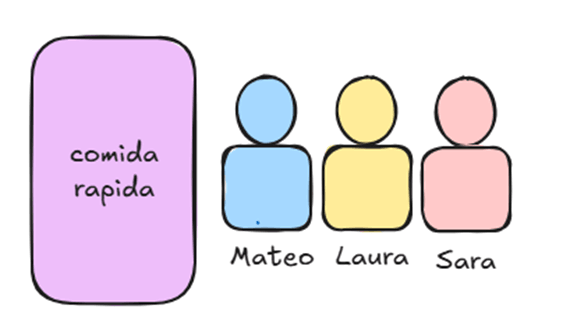
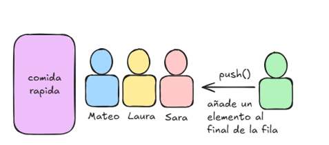
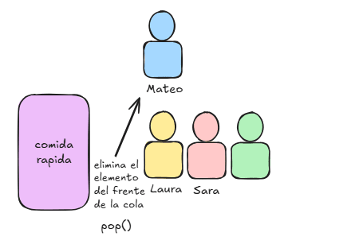
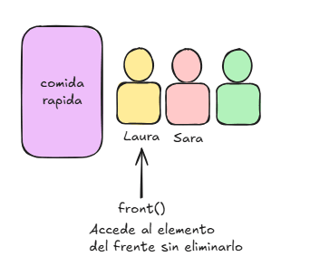
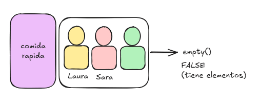
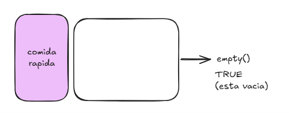
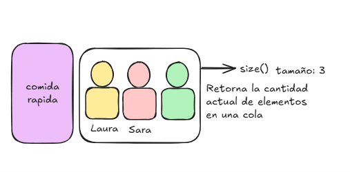

# Estructura de datos: QUEUE

## Planteamiento del problema:
Imagina que estas en una fila de un puesto de comida rápida:
* **Cliente 1:** Mateo, llego a la fila a las 12:00pm para pedir una hamburguesa.
* **Cliente 2:** Laura, llego a la fila a las 12:05pm para pedir una pizza.
* **Cliente 3:** Sara, llego a la fila a las 12:10pm para pedir un perro caliente.



El cajero del puesto solo puede atender a un cliente a la vez. Si el cajero no tuviera un orden para atender a los clientes o decidiera atender primero a Sara (la ultima en llegar) o algún orden aleatorio, la experiencia seria injusta para Mateo y Laura, provocando desorganización y molestia.

Para organizar el flujo de pedidos de manera justa, el puesto de comida rápida implementa una regla: **“el primer cliente que llega a la fila debe ser el primero en ser atendido e irse con su pedido”**.

---

# Cola (QUEUE)

Una **Cola (queue)** es una estructura de datos lineal que sigue el principio **FIFO** (*First In, First Out* - Primer en entrar, Primero en salir).

Es el modelo exacto de una fila de personas en la vida real: la primera persona en llegar va al frente (*front*) de la fila y las nuevas personas que van llegando se van añadiendo por la cola (*rear*).

## Operaciones:
Las operaciones principales permiten agregar, consultar y retirar elementos, además de conocer el estado y el tamaño de la cola:

* **`push()` — Enqueue:** Agrega un elemento al final de la cola. Por ejemplo, si Mateo, Laura y Sara ya están en la fila, al agregar a otro cliente, él queda detrás de Sara.

  

* **`pop()` — Dequeue:** Elimina el elemento que está al frente. En el ejemplo, al atender a Mateo, él sale de la cola y Laura queda en primer lugar.

  

* **`front()`:** Permite consultar cuál es el elemento que está al frente sin eliminarlo. Es útil para saber quién sigue, antes de atenderlo.

  

* **`empty()`:** Indica si la cola está vacía. Devuelve `true` cuando no hay elementos y `false` cuando todavía queda alguno.

  

  

* **`size()`:** Devuelve la cantidad de elementos que hay en la cola en ese momento. Si Mateo, Laura y Sara siguen esperando, el tamaño es 3.

  

---

# Casos de Uso en Programación Competitiva:

A diferencia del desarrollo de software convencional (donde las colas manejan impresión o streaming), en CP las aplicaciones están ligadas a la optimización matemática de algoritmos:

* **BFS (Breadth-First Search):** Es el pilar fundamental de la estructura. La cola almacena los vértices o coordenadas a explorar nivel por nivel, garantizando que el camino hallado a un nodo sea el más corto posible en grafos sin pesos.
* **Algoritmos de Ventana Corrediza (Sliding Window):** Mantenimiento de un registro FIFO continuo de elementos que entran y salen de un rango de evaluación dinámica.
* **Procesamiento de Flujos por Capas (Level-Order Traversal):** Reconstrucción o lectura de árboles binarios y árboles n-arios nivel por nivel.
* **Flood Fill Iterativo:** Algoritmo de relleno de gráficos/matrices utilizado para evitar desbordamientos de pila (*Stack Overflow*) provocados por la recursividad del enfoque DFS tradicional.

---

# Hora de Programar:

En C++ podemos usar la cola ya implementada en la biblioteca estándar mediante `std::queue`. El siguiente programa agrega los nombres de Mateo, Laura y Sara, y luego los atiende en el mismo orden en que llegaron:

```cpp
#include <bits/stdc++.h> // La superlibrería de Lasso: jala todo el arsenal de C++ de un golpe
using namespace std;    // Nos ahorra escribir el aburrido std:: antes de cada comando

int main() {
    // Fast I/O: Apaga la sincronización lenta para evitar que el código nos dé TLE
    ios_base::sync_with_stdio(false);
    cin.tie(NULL);

    queue<string> q; // Creamos la fila del puesto de comida rápida para guardar palabras
    
    // Enqueue: Llegan los clientes en orden de tiempo y se forman al final (O(1))
    q.push("Mateo"); // Llega Mateo a las 12:00pm (queda al frente por llegar primero)
    q.push("Laura"); // Llega Laura a las 12:05pm y se forma detrás de Mateo
    q.push("Sara");  // Llega Sara a las 12:10pm y queda al final de la cola (rear)

    cout << "--- Procesando elementos de la cola ---" << "\n";

    // IsEmpty: El ciclo se repite una y otra vez mientras la fila NO esté vacía
    while (!q.empty()) {
        // Front: Consulta quién es el cliente del frente listo para ordenar (sin sacarlo)
        string elemento_frente = q.front(); 
        
        cout << "Atendiendo a: " << elemento_frente << "\n"; // Atendemos al cliente del frente
        
        // Dequeue: El cliente recibe su pedido y abandona la fila definitivamente (O(1))
        q.pop(); 
    }

    // Verificación final: Confirmamos si ya todos los clientes fueron atendidos con éxito
    if (q.empty()) {
        cout << "\nCola vacía. Todos los elementos se procesaron con éxito." << "\n";
    }

    return 0;
}
```

### En pantalla se mostraría:
```text
--- Procesando elementos de la cola ---
Atendiendo a: Mateo
Atendiendo a: Laura
Atendiendo a: Sara

Cola vacía. Todos los elementos se procesaron con éxito.
```